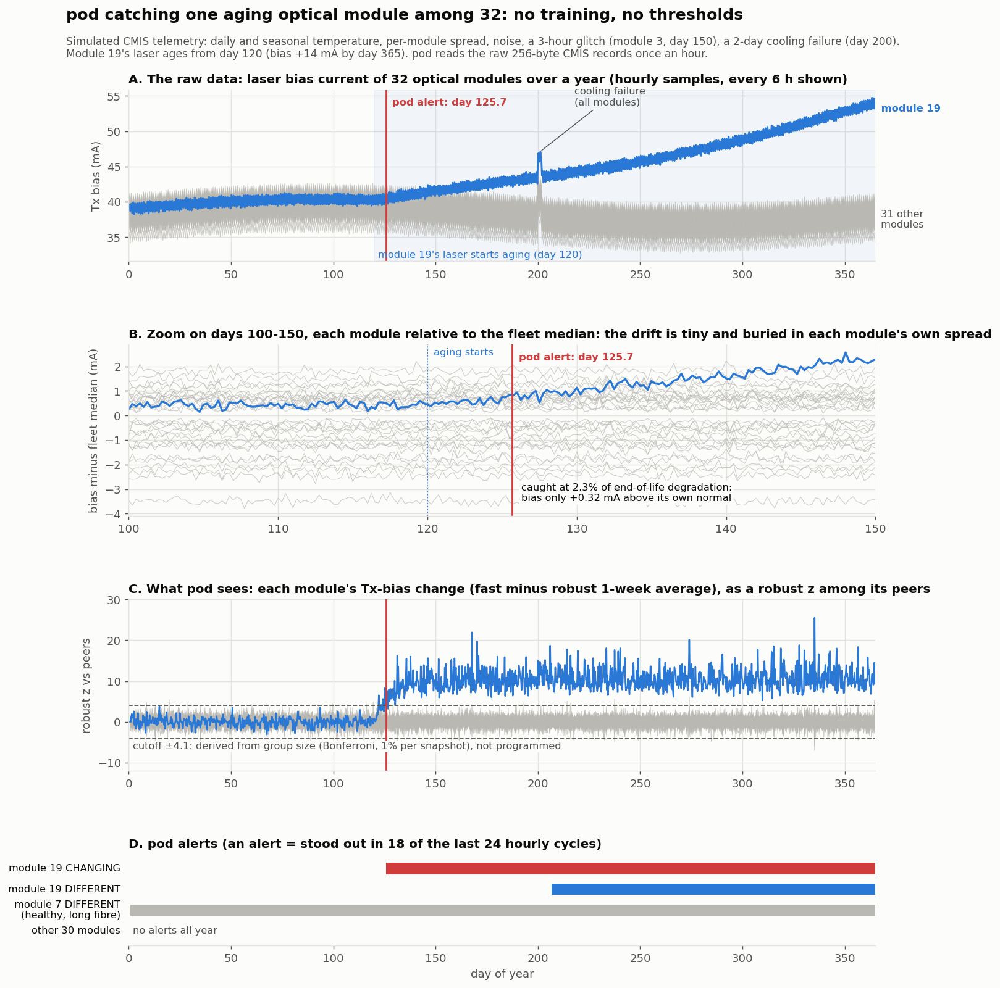

# pod: peer outlier detection

**Find the one that's going wrong among many similar things, on a small
microcontroller, with no training and no thresholds to program.**

pod watches a population of similar *entities* (optical modules, fans, pumps,
power supplies, disks, sensors...), each described by the same handful of
numeric *features*, and points out the one that stands out from its peers.

- **No pretraining.** Nothing is learned offline and no model is shipped.
  Every cycle, pod fits an Isolation Forest to the live population.
- **No programmed limits.** There is no "temperature must stay below X"
  anywhere. pod knows nothing about units or physics; an entity is unusual
  only *relative to its peers*.
- **Sizes chosen at runtime.** Any number of entities (up to 65535) and
  features (up to 1024); memory is the practical limit.
- **Portable C.** Core in C99 plus `<math.h>`: no allocation, no I/O, no OS,
  no globals. Builds with plain CMake for any target, and is also a Zephyr
  module.
- **Small.** About 4 KB of code; 6.4 KB of RAM for 32 entities × 7 features.
- **Explains itself.** Each alert names the feature that sets the entity
  apart, and by how much.



*One aging optical module among 32, over a simulated year. pod flags it on
day 125.7, when its laser bias is only 0.32 mA above its own normal: well
inside the fleet's spread and daily swing. No other module raises a CHANGING
alert, and a site-wide cooling failure cancels out. Reproduce it with
[examples/cmis_drift](examples/cmis_drift/).*

## How it works, in one paragraph

Each cycle, pod pulls every entity's features through a callback you supply.
It keeps a short and a long robust running average per feature, and compares
every entity with its peers in two **views**: *DIFFERENT* (current values)
and *CHANGING* (recent change). Two complementary tests run in each view:

- an **Isolation Forest** fitted on the current group, which catches
  combinations of small deviations;
- a **robust per-feature z-score** with a Bonferroni-corrected cutoff, which
  catches a single feature far from the group.

An entity that stands out persistently (18 of the last 24 cycles by default)
raises an **alert**. Problems every entity shares, such as the room warming
up, cancel out. See [docs/how-it-works.md](docs/how-it-works.md).

## Quick start

```c
#include "pod/pod.h"

#define N 40   /* entities */
#define D 4    /* features */

/* Fill out[0..D-1] with entity i's current values; return false to skip it. */
static bool read_pump(void *user, unsigned i, float *out)
{
        const struct pump *p = &((const struct pump *)user)[i];
        out[0] = p->flow;
        out[1] = p->pressure;
        out[2] = p->current;
        out[3] = p->vibration;
        return p->online;
}

static struct pump pumps[N];
POD_MEM_DEFINE(pod_mem, N, D);           /* all of pod's memory, static */
static struct pod pod;

void init(void)
{
        pod_init(&pod, NULL, N, D, read_pump, pumps, pod_mem, sizeof(pod_mem));
}

void every_hour(void)
{
        if (pod_update(&pod) > 0) {      /* number of entities in alert */
                for (unsigned i = 0; i < N; i++) {
                        const struct pod_result *r = pod_result(&pod, i);
                        if (r->flags & POD_FLAG_ALERT_CHANGING)
                                report(i, r->top_feature[POD_VIEW_CHANGING],
                                          r->top_feature_z[POD_VIEW_CHANGING]);
                }
        }
}
```

A complete, runnable version is in [examples/basic](examples/basic/main.c).
For the optical-module case, with dataset and plot, see
[examples/cmis_drift](examples/cmis_drift/).

## Building

**Any toolchain, with CMake:**

```sh
cmake -S . -B build
cmake --build build
ctest --test-dir build              # host tests
./build/pod_example_basic           # the example above, simulated
```

Targets: `pod` (the core library) and `pod_cmis` (the optical-module
adapter). Options: `POD_BUILD_CMIS`, `POD_BUILD_TESTS`, `POD_BUILD_EXAMPLES`.
Use it from another CMake project with `add_subdirectory(pod)` and
`target_link_libraries(app PRIVATE pod)`.

**Without a build system:** compile `src/iforest.c`, `src/robust.c` and
`src/pod.c` with `include/` on the include path, and link the maths library.

**Zephyr:** add the repository as a module (`ZEPHYR_EXTRA_MODULES` or a west
manifest entry) and set `CONFIG_POD=y`. On SoCs with an FPU,
`CONFIG_POD_FPU` turns it on automatically.

See [docs/integration.md](docs/integration.md) for memory, timing, FPU and
threading details.

## Documentation

| Document | Contents |
|---|---|
| [docs/how-it-works.md](docs/how-it-works.md) | The algorithm: smoothing, the two views, Isolation Forest, robust z, persistence |
| [docs/api.md](docs/api.md) | Every type, function, flag and configuration field |
| [docs/integration.md](docs/integration.md) | CMake, Zephyr, bare metal; memory, timing, FPU, threading |
| [docs/adapters.md](docs/adapters.md) | Writing a read callback for your data; the CMIS optical-module adapter |
| [docs/pod-summary.txt](docs/pod-summary.txt) | A plain-text overview of all of the above |

## Repository layout

```
include/pod/        public headers: pod.h (engine), iforest.h, robust.h
src/                core implementation (C99)
adapters/cmis/      CMIS optical-module adapter (C11)
examples/basic/     portable host example (pumps)
examples/cmis_drift/ optical-module drift dataset and plot
tests/host/         unit tests and simulated scenarios
sim/                simulated CMIS module fleet used by tests and the sample
samples/fleet_sim/  Zephyr sample and on-target benchmark
zephyr/             Zephyr module glue (Kconfig, CMake)
```

## Validation

All results so far come from simulated data:

- **Optical modules** (32 modules, one simulated year, with daily and
  seasonal temperature, per-unit spread, noise, a glitch and a site-wide
  cooling failure). Laser aging was caught about 6 days into a 245-day
  degradation, and fibre loss about 10 days into a 275-day one, with no false
  alerts in the reference fleet. Across 10 random fleets, every degradation
  was caught within 4–11 days.
- **Fans** (50 fans, 3 features): bearing wear caught 2.8 days after it began.
- **Pumps** (the example: 40 pumps, 4 features): impeller wear caught 2 days
  after it began.

On real hardware, an earlier version took about 0.5 s per cycle for 32 × 7
with 100 trees on a 96 MHz Cortex-M33 without an FPU. The current version is
about 2.4× faster on the host.

CI runs the tests with gcc, clang and sanitizers, and cross-compiles the
library for Cortex-M0+, Cortex-M4F and RV32IMAC.

## Limits

- pod finds the *odd one out*; it can't judge severity. Use the reported
  feature and z.
- A problem shared by the whole group is invisible by design.
- Groups need at least 8 like entities by default, and only like entities
  should share a group.
- The data here is simulated; expect to tune the features for your domain.

## License

Apache-2.0. See [LICENSE](LICENSE).
