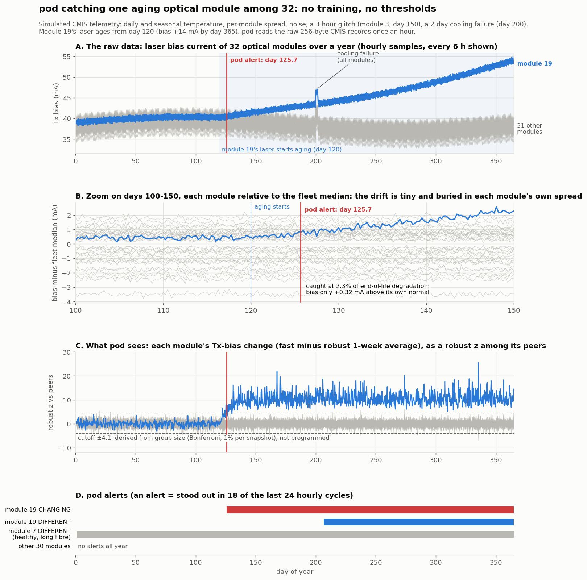

# Drift demo: one aging optical module among 32



A year of simulated CMIS telemetry for 32 optical modules, with:
- daily and seasonal temperature swings;
- per-module and per-lane spread, plus measurement noise;
- a healthy module on a long fibre (7);
- a 3-hour Rx glitch (module 3, day 150);
- a 2-day cooling failure that heats every module (day 200).

From day 120, module 19's laser starts to age: its bias current creeps up
by 14 mA over the rest of the year.

pod runs once per simulated hour on the raw 256-byte CMIS records. It raises
a CHANGING alert for module 19 on **day 125.7**. At that point the module is
at 2.3% of its end-of-life degradation, and its bias is only 0.32 mA above
its own normal, which is far inside the module-to-module spread and the
daily temperature swing. No other module raises a CHANGING alert all year.

The cooling failure moves every module at once, so it cancels out. Module 7
is flagged DIFFERENT all year: it's permanently unlike its peers, but it's
stable.

## Files

| File | Contents |
|---|---|
| `main.c` | runs the simulation and pod, writes the dataset |
| `plot.py` | draws the figure (Python 3, matplotlib, numpy) |
| `data/timeseries.csv` | every 6 h: `day`, the aging module's `degradation`, the per-feature `cutoff`, each module's raw Tx bias (`bias_0..31`, mA), and the robust z of its Tx bias change among its peers (`z_0..31`) |
| `data/alerts.csv` | every alert set or clear, at hourly resolution: module, view, top feature, its z, and the degradation at that moment |

## Reproduce

```sh
cmake -S . -B build && cmake --build build
./build/pod_example_cmis_drift examples/cmis_drift/data
python3 examples/cmis_drift/plot.py examples/cmis_drift/data docs/images/cmis-drift.png
```

The simulation is deterministic, so the output matches the committed files.
